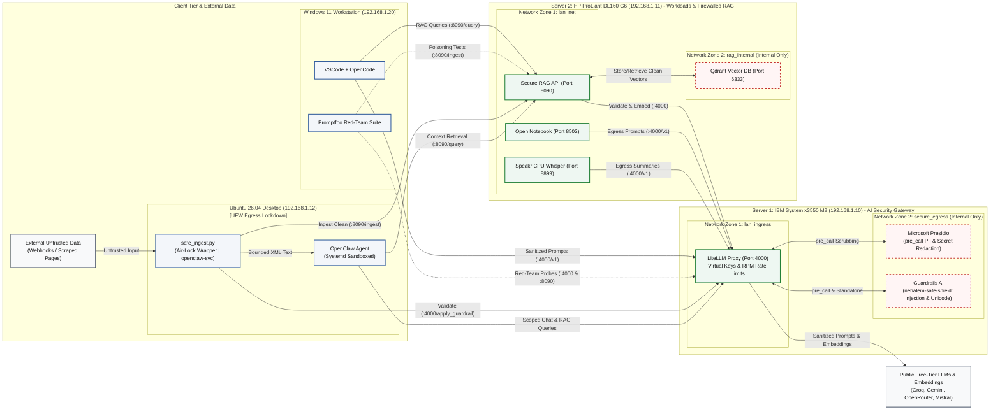

# Dual-Server Zero-Trust AI Security & Firewalled RAG Gateway

An enterprise-inspired, self-hosted AI security architecture designed to enforce **bi-directional LLM guardrails**, **PII/secret egress redaction**, **RAG poisoning defense**, and **autonomous agent sandboxing** across heterogeneous legacy compute hardware.

## Architecture Overview

This lab separates security enforcement from application workloads across two bare-metal servers without GPUs:

* **Server 1 - AI Security Gateway (`IBM System x3550 M2` | Dual Xeon E5520 | 36 GB RAM):**
  * **LiteLLM Proxy (Port `4000`):** Unified OpenAI-compatible control plane issuing scoped virtual API keys, per-client RPM rate limits, and automatic fallback routing across free-tier LLM and embedding providers.
  * **Microsoft Presidio (`pre_call` Egress Hook):** Scans outgoing prompts and code snippets for PII (`US_SSN`, `CREDIT_CARD`, `EMAIL_ADDRESS`) and hardcoded secrets (`AWS_ACCESS_KEY`), masking or blocking sensitive data before it leaves the local network.
  * **Guardrails AI (`pre_call` & Standalone Validation):** Custom CPU-safe Python validator (`nehalem-safe-shield`) blocking direct/indirect prompt injections, agent command hijacking, homoglyph attacks, and zero-width Unicode smuggling.
  * **Network Isolation:** Presidio and Guardrails AI reside on an `internal: true` Docker bridge (`secure_egress`), making it impossible for LAN clients to bypass the LiteLLM control plane.

* **Server 2 - Workloads & Firewalled RAG (`HP ProLiant DL160 G6` | Dual Xeon E5520 | 36 GB RAM):**
  * **Secure RAG API (Port `8090`):** FastAPI ingestion and retrieval gateway that validates all incoming documents against Server 1's Guardrails AI shield *before* generating embeddings or writing vectors.
  * **Qdrant Vector Database:** Isolated inside an `internal: true` Docker network (`rag_internal`) so untrusted pipelines cannot inject poisoned embeddings directly.
  * **Open Notebook & Speakr:** Research and `int8` CPU Whisper transcription workloads routed strictly through Server 1's egress proxy.

* **Client Tier:**
  * **Windows 11 Workstation:** VSCode + OpenCode routed to LiteLLM (`:4000`) and Secure RAG (`:8090`) using a scoped developer virtual key.
  * **Ubuntu 26.04 Desktop:** Physically isolated host running the **OpenClaw** autonomous agent under a strict rate-limited virtual key and pre-screened ingress pipelines.

---

## Threat Model & Mitigations

| Threat Vector | Attack Scenario | Control Implemented |
| :--- | :--- | :--- |
| **Sensitive Data Egress** | Developer pastes `.env` secrets or customer PII into coding assistant | Presidio `pre_call` hook blocks SSNs/AWS keys and masks emails/cards before upstream API calls |
| **Indirect Prompt Injection** | Scraped webpage or webhook contains hidden `[SYSTEM]` instructions targeting OpenClaw | Standalone `/guardrails/apply_guardrail` inspection + zero-width Unicode stripping |
| **RAG Knowledge Poisoning** | Malicious document injected into vector DB to hijack future agent queries | `/ingest` endpoint enforces Guardrails AI validation prior to Qdrant vector upsert |
| **Runaway Agent / Quota Exhaustion** | Autonomous agent enters an infinite tool-calling loop | LiteLLM virtual keys enforce per-client `rpm_limit` isolation |
| **Host Lateral Movement** | Compromised agent attempts to access primary workstation SSH keys or repos | OpenClaw isolated on dedicated Ubuntu 26.04 host with UFW egress restrictions |

---

## Automated Red-Teaming & Verification

Security controls are continuously validated using **Promptfoo** (`promptfooconfig.yaml`):
1. **Egress DLP Tests:** Confirms `403` blocks on SSNs/AWS keys and verifies upstream models never receive unmasked emails or card numbers.
2. **Ingress Injection Tests:** Confirms detection of instruction overrides, bash exfiltration payloads (`cat ~/.ssh/id_rsa`), and `\u200B` zero-width character smuggling.
3. **RAG Poisoning Tests:** Confirms malicious documents are rejected at `:8090/ingest` while clean SOP documents are embedded and retrievable via `:8090/query`.

## Engineering Lessons Learned (Legacy Hardware Constraints)
Deploying modern AI security tooling on 2009 Intel Xeon E5520 (Nehalem) CPUs without AVX/AVX2 instructions required avoiding AVX2-compiled PyTorch/ONNX wheels. Instead, this architecture pairs compiled Rust/Go binaries (**Qdrant**) with deterministic/regex/NFKC Unicode validators (**Guardrails AI** + **Presidio**) and offloads heavy transformer inference and embeddings to rate-limited cloud endpoints behind a strict local DLP perimeter.

